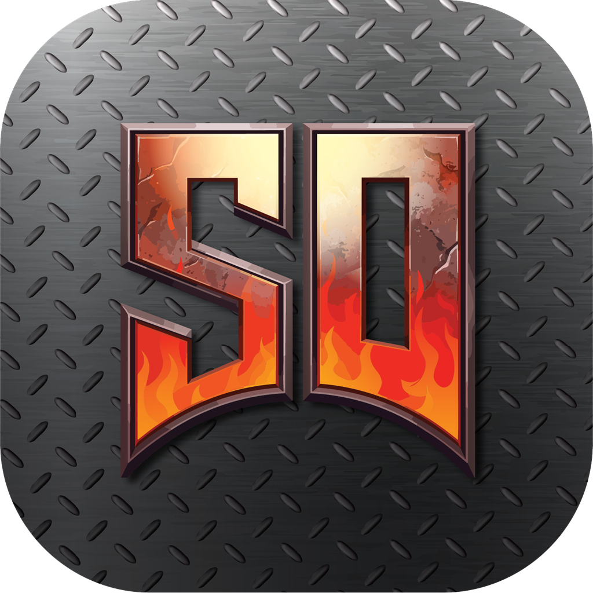
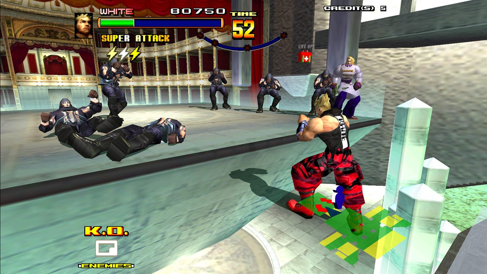
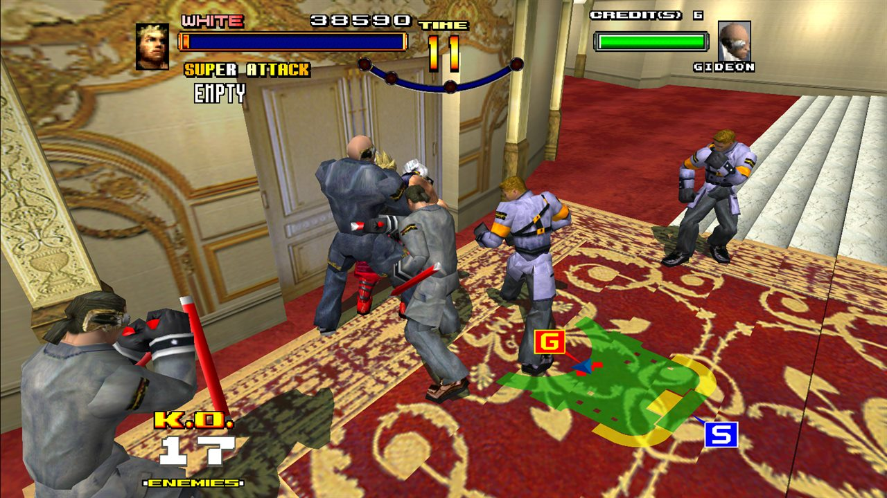
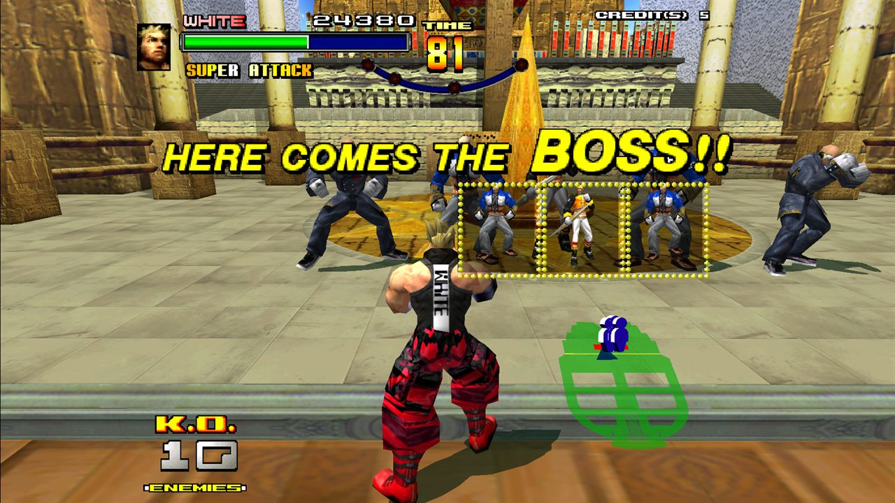
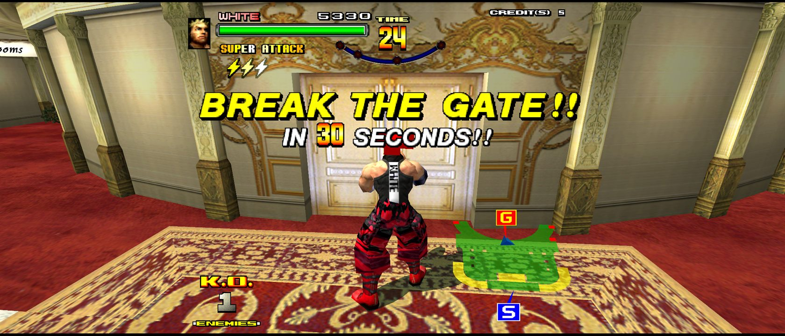
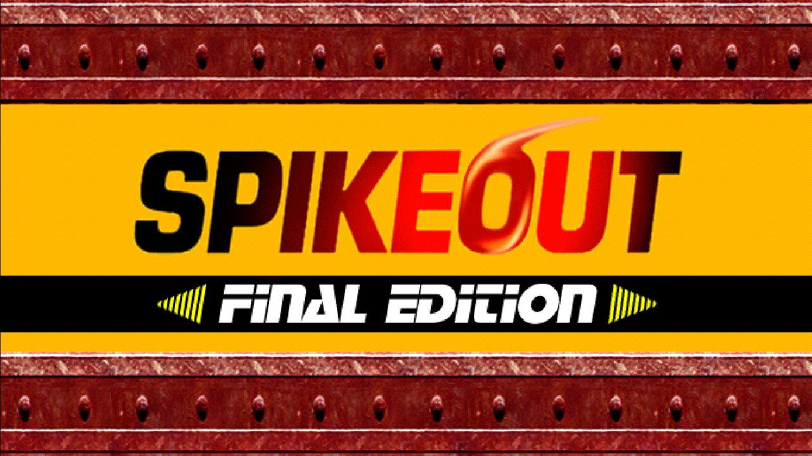
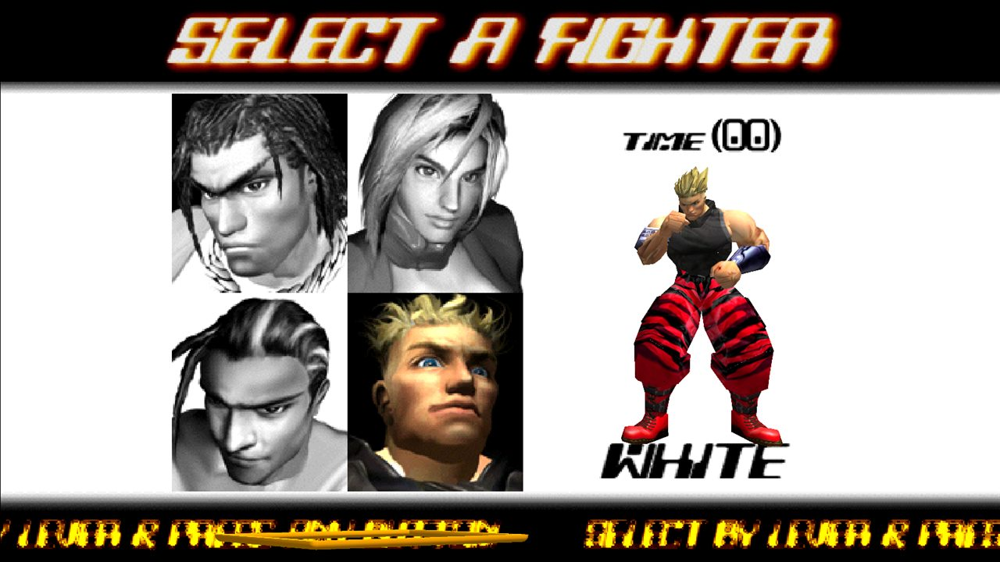
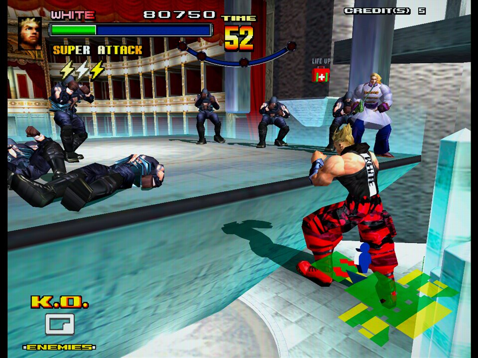
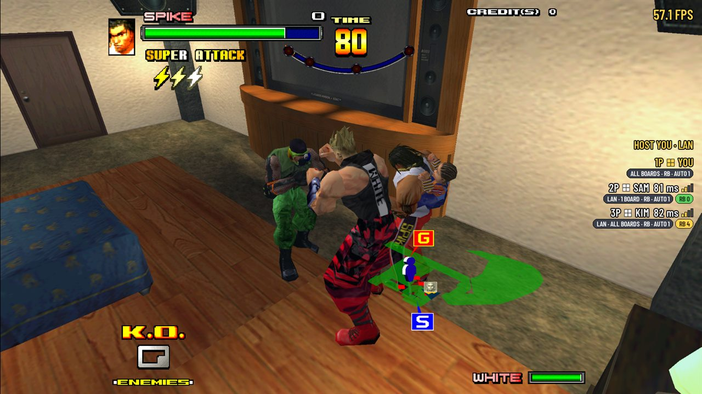

<p align="center"></p>

<h1 align="center">Spikeout: Final Edition Recomp</h1>

<p align="center"><b>Spikeout: Final Edition (SEGA, arcade, Model 3, 1999) as a native PC game: the game's own PowerPC
program translated to native code, the 3D on the GPU at up to 6x the arcade's resolution, widescreen up to 21:9, and
four-player co-op over the internet, one player a PC, as four linked cabinets played it.</b></p>

<p align="center">
  <a href="https://github.com/tastyrepublic/spikeout-recomp/releases/latest"></a>
  <a href="LICENSE"></a>
  
  <a href="https://buymeacoffee.com/donfy"></a>
</p>

<p align="center">
  <a href="https://github.com/tastyrepublic/spikeout-recomp/releases/latest">Download</a> ·
  <a href="#play">Install</a> ·
  <a href="#controls">Controls</a> ·
  <a href="#online-play">Online play</a> ·
  <a href="#faq">FAQ</a> ·
  <a href="https://github.com/tastyrepublic/spikeout-recomp/issues">Report a bug</a> ·
  <a href="https://buymeacoffee.com/donfy">Buy me a coffee</a>
</p>

<p align="center">
  
</p>

> [!IMPORTANT]
> No game files are included: no ROMs and nothing made from them. You need your own dump of the game as MAME's and
> Supermodel's `spikeofe` set (`spikeofe.zip`). It is read on your computer, and the game's program is translated
> there on the first start. An unofficial fan project, not made, approved or supported by SEGA, and not affiliated
> with it.

## About

Spikeout was SEGA's four-player beat 'em up for linked arcade cabinets: each player stood at their own cabinet, and
the cabinets' network boards joined them into one game. This project runs the game's own program, written for the
Model 3 board's PowerPC 603e, translated to native code for your PC, and rebuilds the rest of the board in its own
code: the Real3D graphics, the tile generator's 2D layers, the two SCSP sound chips and their 68000, the MPEG music
board, the network board and its link, the inputs and EEPROM. [Supermodel](https://github.com/trzy/Supermodel) is
the reference for how the hardware behaves, and every change to what the game shows or plays is checked against it.

The game isn't emulated an instruction at a time: on its first start, the program in your ROM set is analysed and
translated once with LLVM (about 15-25 seconds on a six-core PC), and kept, so later starts take a moment. That
translation is checked against the project's own ahead-of-time build by recordings of play, RAM hash for RAM hash.

## Status

| Area | State |
| --- | --- |
| The game: attract mode, every stage, the ending, the rankings | Working |
| The 3D on the GPU (Vulkan) or in software | Working: render scale up to 6x, antialiasing, quads drawn whole |
| Widescreen (16:10, 16:9, 21:9) | Working: the fights see more to the sides; the 2D screens (the intro, the title and its doors, the fighter select, the linking screen) widened from the game's own art |
| Sound and music | Working: the cabinet's front and rear speakers apart, on four channels or two outputs |
| Online play: up to four players, each on their own PC | Working, experimental: an internet lobby with room codes, games on your own network found automatically, rollback, spectators (see [Online play](#online-play)) |
| Save states | Working (one player, not in network games) |
| Windows 10 / 11 (64-bit) | Working |
| Linux / Steam Deck (x86-64) | Working on Ubuntu 24.04; the Steam Deck not tried yet |
| macOS | Not yet: it needs the translator's macOS work |

**This is a preview.** Please report anything that looks or plays differently from the arcade in
[Issues](https://github.com/tastyrepublic/spikeout-recomp/issues).

## Play

| System | Download |
| --- | --- |
| Windows 10 or 11 (64-bit) | `spikeout-<version>-windows-x64.zip` |
| Linux / Steam Deck (x86-64: glibc 2.38 or later, OpenSSL 3) | `spikeout-<version>-linux-x64.tar.gz` |

**Windows**

1. Unzip it anywhere (not inside Program Files).
2. Run `spikeout.exe`. Windows may say "Windows protected your PC": the program isn't signed. Choose More info, then
   Run anyway.
3. Choose your `spikeofe.zip` when it asks. The game is then prepared from it, once; it remembers where the zip is.

**Linux**

1. Unpack it anywhere: `tar -xzf spikeout-<version>-linux-x64.tar.gz`.
2. Run `./spikeout` in its folder, and choose your `spikeofe.zip` when it asks.

**Steam Deck**

1. In Desktop Mode, copy the download to the Deck (e.g. Downloads) and unpack it there: right-click it in the file
   manager > Extract > Extract archive here. (Unpacking it on Windows can lose the file's permission to run.)
2. Steam > Games > Add a Non-Steam Game to My Library > Browse, set the file type to "All files", pick `spikeout` in
   its folder, Add Selected Programs. Leave Compatibility's "Force the use of a specific Steam Play compatibility
   tool" off: it's a native Linux game.
3. Start it once in Desktop Mode to choose your `spikeofe.zip`; after that, play it from Game Mode.

**Where things are kept:** your settings, the cabinets' settings and rankings and the translated game are in your
user data folder (Windows `%APPDATA%\spikeout-recomp\Spikeout`, Linux `~/.local/share/spikeout-recomp/Spikeout`).
Put an empty file named `portable.txt` next to the program and they're kept in its folder instead. Save states
(<kbd>F9</kbd>) and screenshots (<kbd>F12</kbd>) go in the folder the game was started from.

## Controls

Change them in the menu (<kbd>Esc</kbd>), under Controls.

| Key | Does |
| --- | --- |
| <kbd>↑</kbd> <kbd>↓</kbd> <kbd>←</kbd> <kbd>→</kbd> | Move |
| <kbd>Z</kbd> <kbd>X</kbd> <kbd>C</kbd> <kbd>V</kbd> | Beat, charge, jump, shift |
| <kbd>5</kbd> / <kbd>1</kbd> | Coin / start |
| <kbd>Esc</kbd> | The menu (a pad: Guide, the touchpad, or Back + Start) |
| <kbd>F9</kbd> / <kbd>F10</kbd> | Save state / load the last (press twice; <kbd>F9</kbd> within 5 seconds undoes it) |
| <kbd>F12</kbd> | A screenshot (in the folder the game was started from) |
| <kbd>Tab</kbd> (held) | As fast as it goes |
| <kbd>F2</kbd> / <kbd>F1</kbd> | The arcade's test and service buttons |

Gamepads: d-pad or left stick, A beat, X charge, B jump, Y shift, Start, Back coin. Free play is the game's own
setting: Esc > Game > Arcade settings.

## Features

- **Render scale** up to 6x the arcade's 496 x 384, or Auto to fit the window; antialiasing; quads drawn whole
  (Supermodel's quad rendering).
- **Picture shape**: the arcade's 4:3, the window's, 16:10, 16:9 or 21:9. In widescreen the fights see more to the
  sides, and the game's 2D screens are widened from its own tile maps.
- **CRT colours** as arcade monitors showed them (Supermodel's), and **screen filters**: scanlines, or a CRT's.
- **The cabinet's sound**: the front and rear speakers apart, on a four-channel output or two outputs.
- **The arcade's settings**, as an operator sets them: difficulty, region, free play, the demo's sound, and its test
  menu.
- **Save states**, checked before they load and kept across updates.

<p align="center">
  
  
</p>
<p align="center">
  
  <br><sub>21:9: the fights see more to the sides</sub>
</p>
<p align="center">
  
  
  <br><sub>The 2D screens widened from the game's own tile maps: the title's doors, the fighter select</sub>
</p>
<p align="center">
  
  <br><sub>The arcade's 4:3, with a Sega arcade monitor's colours and the CRT filter</sub>
</p>

## Online play

Each player plays on their own PC, as each player had their own cabinet. Every PC runs all the cabinets of the game
and only the players' inputs travel, so the game is the same on every screen.

<p align="center">
  
  <br><sub>Three players, one PC each: the seat list shows who's in the game and each one's connection</sub>
</p>

- **Host a game** (Esc > Network play): on the internet lobby, or only on your own network. You get a six-character room
  code to share; private rooms are joined by code only.
- **Join a game**: the list shows the games on the lobby and on your own network (no setup, nothing to forward), or
  join by code. Players can join a game already started; their cabinet joins as a new player joins a linked cabinet.
- **No settings to tune**: the input delay and rollback are set automatically from how far apart the players are.
- **Spectators**: up to four can watch a game (Watch in the list, or by code), a moment behind, never slowing the
  players.
- **If the host leaves**, the game goes on and another player hosts it, under the same room code.
- **Weaker PCs** (a handheld, an older laptop) automatically run only their own cabinet in full; there is no setting for it.

What it took to get there is written up in [docs/netplay.md](docs/netplay.md): the linked cabinets running in slow
motion until the network board's ring was modelled, four boards on one PC, and keeping every PC's game identical.

## Roadmap

- macOS (Apple silicon and Intel)
- Smooth motion: pictures made between the game's frames, for high-refresh screens
- A direct cable mode: each PC runs only its own cabinet, the link over your network, for handhelds on one hotspot
- Maybe direct connections by address
- The menu in Chinese and Japanese
- Later: Android, iOS, Xbox, Switch (one player)

## FAQ

**Where do I get the ROM set?** From your own arcade board. The project can't help you find one.

**It says the ROM set's files differ.** The game is translated from your program ROM, so only the known good set is
accepted: MAME's and Supermodel's `spikeofe`.

**Why does the first start take a while?** The game's program is translated from your ROM set, using every core;
it's kept, so that happens once (and again after an update or with another ROM set).

**Can I play with someone on another system?** Yes: Windows and Linux play together, as long as both have the same
version.

**How do I know a new version is out?** At start the game asks GitHub whether there's a newer release, and the menu
says so, with a link to its page; the lobby also tells you when a game is on another version. The game doesn't update
itself. The check can be turned off (Esc > Game > Check for updates).

**Is it emulation?** The board's chips are rebuilt in code, as an emulator does, but the game's own program runs as
native code on your CPU, translated once, not instruction by instruction while it plays.

## Building

Requires CMake 3.20+ and a C++20 compiler (GCC 13+, Clang 17+ or Visual Studio 2022; on Windows, MinGW-w64 GCC from WinLibs is what's
used).

```sh
cmake -S . -B build
cmake --build build
ctest --test-dir build --output-on-failure
```

The first configure downloads SDL 3, the menu's libraries (RmlUi, FreeType) and the shader compilers. On Linux, SDL
needs the X11 or Wayland and audio development packages; on Debian or Ubuntu (SDL's list, from its
`docs/README-linux.md`), with OpenSSL for the lobby's connection:

```sh
sudo apt-get install libasound2-dev libpulse-dev libaudio-dev libfribidi-dev libjack-dev libsndio-dev \
  libx11-dev libxext-dev libxrandr-dev libxcursor-dev libxfixes-dev libxi-dev libxss-dev libxtst-dev \
  libxkbcommon-dev libdrm-dev libgbm-dev libgl1-mesa-dev libgles2-mesa-dev libegl1-mesa-dev \
  libdbus-1-dev libibus-1.0-dev libudev-dev libthai-dev libusb-1.0-0-dev \
  libpipewire-0.3-dev libwayland-dev libdecor-0-dev liburing-dev libcurl4-openssl-dev libssl-dev
```

**The game as the downloads have it** (translated at start, nothing from the ROM in the program):
`-DSPIKEOUT_LLVM_JIT=ON` builds `spikeout-jit` (the window) and `gamerun-jit`. The first configure downloads LLVM
18.1.8's source and builds it once with your compiler, into `%LOCALAPPDATA%/spikeout-llvm` or
`~/.cache/spikeout-llvm` (about 40 minutes on six cores). `tools/make-release.ps1` packages the downloads.

**The game compiled ahead of time** (for development and the proofs): point CMake at your unzipped ROM set,
`-DSPIKEOUT_ROM_DIR=path/to/spikeofe`, and the build recompiles the game into `build/generated/` and builds
`spikeout` and `gamerun`. That code is made from your ROMs: it stays in the build folder and is never committed or
shared.

The tools: `romcheck` checks a ROM set, `ppcdis` and `codemap` disassemble and map the code, `ppcrecomp`
recompiles it, `gamerun` runs the game without a window (screenshots, recordings and replays, save states, sound to
WAV, network play between processes; see its file's header), `spikeout` is the game in a window. How it's built
inside: [docs/recompiler.md](docs/recompiler.md), [docs/control-flow.md](docs/control-flow.md),
[docs/hardware-notes.md](docs/hardware-notes.md), [docs/memory-map.md](docs/memory-map.md),
[docs/netplay.md](docs/netplay.md), [docs/fidelity.md](docs/fidelity.md).

## Authors, and the use of AI

- **Don** ([tastyrepublic](https://github.com/tastyrepublic)): the project, its direction and every decision on how
  the game should look, sound and play; the testing on real PCs, pads and networks.
- **Claude** (Anthropic's AI model, through [Claude Code](https://claude.com/claude-code)): a contributor to every
  commit, writing much of the code and the documentation.

This project is made with AI. Claude writes code, runs the tests and investigates, at Don's direction; Don decides
what's built, plays it, and asks for each change to be committed. What AI writes is held to the same rule as the rest:
a change to what the game shows or plays must be checked against the reference (Supermodel) or proved identical by
hashes (pictures, sound, RAM, recordings, save states), as the docs record. Each commit names Claude as co-author.

## Credits and references

- [Supermodel](https://github.com/trzy/Supermodel): the primary Model 3 hardware reference (ROM layout, address map, Real3D, network board).
- [MAME](https://github.com/mamedev/mame) (`src/mame/sega/model3.cpp`): the second reference, for cross-checking and the ROM set's naming.
- Motorola/IBM *PowerPC 603e RISC Microprocessor User's Manual* and *Programming Environments Manual*.
- [Moira](https://github.com/dirkwhoffmann/Moira) by Dirk W. Hoffmann (MIT, in `third_party/moira`): the 68000 core that runs the network board's firmware and the sound and music boards' programs.
- [minimp3](https://github.com/lieff/minimp3) by lieff (CC0, in `third_party/minimp3`): decodes the music board's MPEG audio.
- [LLVM](https://llvm.org) (Apache 2.0 with LLVM exceptions): translates the game's program at start.
- [SDL 3](https://github.com/libsdl-org/SDL) (zlib licence): the window, the GPU, sound and pads.
- [RmlUi](https://github.com/mikke89/RmlUi) (MIT) and [FreeType](https://freetype.org) (FTL): the in-game menu; RmlUi's SDL GPU renderer is in `third_party/rmlui_sdl_gpu` (MIT).
- [curl](https://curl.se) (curl licence) and [Zstandard](https://github.com/facebook/zstd) (BSD): the lobby's connection, and the network game's state compressed.
- [glslang](https://github.com/KhronosGroup/glslang) (BSD-3-Clause and others) and [SPIRV-Cross](https://github.com/KhronosGroup/SPIRV-Cross) (Apache-2.0), at build time, to compile the GPU shaders.
- [vf3-recomp](https://github.com/mr-finster/vf3-recomp) by mr-finster (MIT): the menu's design and style (`src/ui/menu.cpp`, `assets/ui`), and this page's.
- [Barlow Condensed](https://github.com/jpt/barlow) by the Barlow Project Authors (SIL Open Font License, `assets/fonts`): the menu's typeface.
- MAME's 315-5881 decryption by Andreas Naive, Olivier Galibert and David Haywood (BSD-3-Clause; in `src/runtime/crypt315_5881.cpp`, with their notice), as Supermodel also uses it.

See [docs/REFERENCES.md](docs/REFERENCES.md) for how sources are used.

## Support the project

Spikeout: Final Edition Recomp is free, and always will be. It's made in spare time by one person (with an AI
helper), and it has a long road ahead: if it brought back some arcade nights for you, a coffee helps it keep going.

<p align="center">
  <a href="https://buymeacoffee.com/donfy"></a>
</p>

What your support pays for:

- **The online lobby and its relay**, which run on Cloudflare: the relay carries the games of players whose networks
  can't connect directly, and costs more as more people play.
- **Devices to test on**: a Steam Deck, handhelds, pads, so it plays as well on them as on a PC.
- **Time** for what's next: smooth motion, the cable link mode, more systems.

Not in a position to donate? That helps too:

- **Star the repository**, so more Spikeout players find it.
- **Play online and tell others**: a beat 'em up made for four is best with four.
- **Report what looks or plays differently** from the arcade, in
  [Issues](https://github.com/tastyrepublic/spikeout-recomp/issues): every report makes it closer to the real
  cabinet.
- **Try it on your device** (a Steam Deck, another Linux, a laptop) and say how it runs.

## Licence

GPL-3.0-only. See [LICENSE](LICENSE). The downloads' `THIRD-PARTY-NOTICES.txt` lists the libraries built into them
and their licences.
